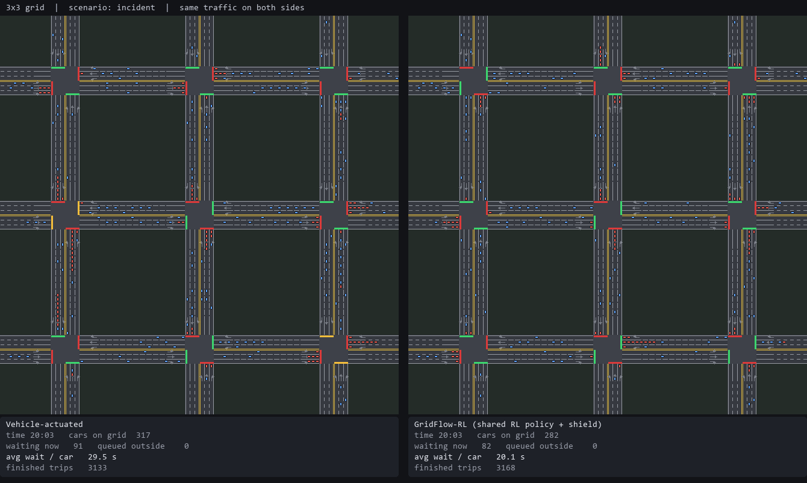
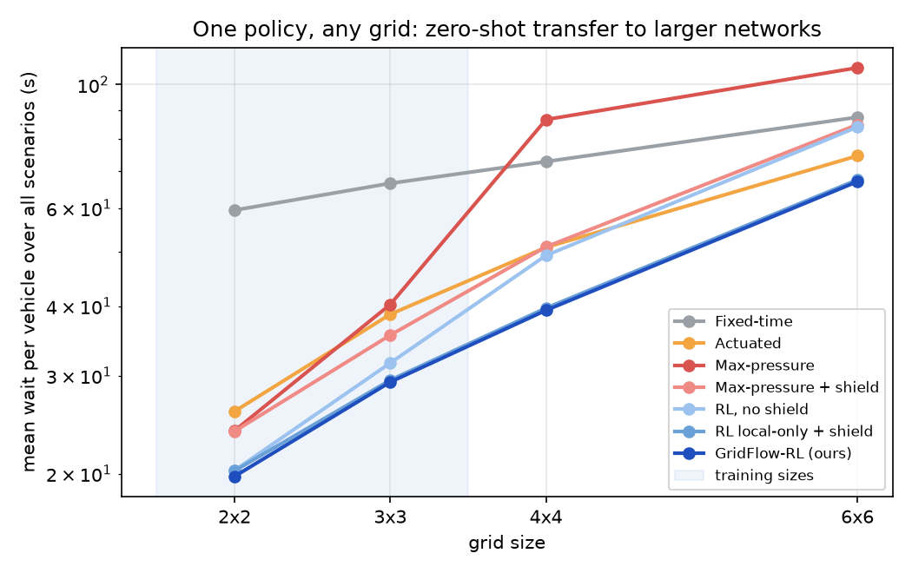
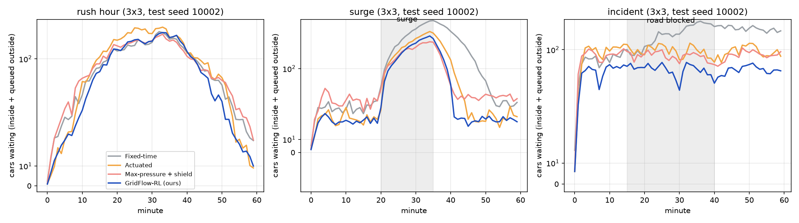

# GridFlow-RL

**One small neural network that runs every traffic light in a city grid — trained on
2×2 and 3×3 grids, deployed without retraining on 4×4 and 6×6 — with a one-line
safety shield that prevents congestion collapse.**



*Same cars, same routes, same crash. Left: classical vehicle-actuated control. Right: GridFlow-RL.
Red cars are stopped, blue are moving; the bars at each junction are the signals.*

---

## Results at a glance

Evaluated on **4 grid sizes × 6 traffic scenarios × 10 held-out test seeds**, every controller
facing *identical* traffic (paired comparison). Metric: average seconds each car spends
stopped, counting cars stuck waiting to enter the city.

| Controller | Mean wait per car | vs best controller in each situation (1.00 = best) | Worst situation |
|---|---|---|---|
| **GridFlow-RL (ours)** | **38.8 s** | **1.03** | 1.36× |
| Vehicle-actuated | 47.5 s | 1.31 | 1.60× |
| Max-pressure + shield | 48.8 s | 1.33 | 2.34× |
| Max-pressure | 64.5 s | 1.58 | 5.19× |
| Fixed-time | 71.5 s | 2.19 | 10.3× |

- **18–46 % less waiting** than every classical controller on average.
- **Best in 15 of 24** (grid, scenario) cells against the *best classical controller picked
  after the fact per cell*; worse in 7, no clear difference in 2 (bootstrap 95 % CIs).
- **Works on grids it never saw**: on 4×4 and 6×6 it stays the lowest-wait controller overall.
- **Honest limits**: a tuned fixed timer is slightly better (1–3 s) under perfectly even
  traffic, and on the largest, most saturated main-road test (6×6 arterial) max-pressure wins.

<p align="center">
 
</p>

Full tables with confidence intervals: [`results/results.md`](results/results.md).

---

## What is new here

1. **A simulator that cannot be gamed.** A cell-based microscopic model with three-lane
   approaches, 1800 veh/h saturation flow, real spillback and gridlock, and entry queues
   whose waiting counts — so a controller cannot "win" by refusing to let cars in.
   Arrivals and routes are fixed by the seed, independent of the controller, so every
   comparison is paired. ([`gridflow/sim.py`](gridflow/sim.py), tests in [`tests/`](tests))
2. **One shared policy for any grid.** Each junction is an agent; all agents share one
   64×64 network (parameter sharing) trained with PPO. Its 24 inputs describe only the
   junction and its immediate surroundings — queues, cars about to arrive, lanes blocked
   by full roads downstream, how full the neighbours' roads are — so the same network
   runs on any grid size. ([`gridflow/marl.py`](gridflow/marl.py))
3. **A safety shield.** *If the chosen green cannot move a single car but the other
   direction can, switch.* One rule, applied at run time, no retraining. It cuts waiting
   by ~25 % on the unseen 4×4 and 6×6 grids by preventing congestion collapse, and it
   also rescues max-pressure. ([`gridflow/controllers.py`](gridflow/controllers.py))

### Ablations

| Grid | Full method | Without shield | Without neighbour view |
|---|---|---|---|
| 2×2 | 19.8 s | +3 % | +2 % |
| 3×3 | 29.2 s | +8 % | +1 % |
| 4×4 *(unseen)* | 39.3 s | **+25 %** | +1 % |
| 6×6 *(unseen)* | 67.0 s | **+25 %** | +1 % |

The shield matters most exactly where it should: on unseen, larger networks. The explicit
neighbour view adds little once the agent can see its own blocked lanes — that local
signal already carries most of the downstream information. We report it as found.

---

## How the evaluation stays honest

- **Held-out everything**: training uses only random steady demand on 2×2 and 3×3.
  Rush hour, surge and incident scenarios, 4×4 and 6×6 grids, and test seeds 10000+ are
  never seen in training.
- **Strong, tuned baselines**: fixed-time, vehicle-actuated and max-pressure (Varaiya
  2013), each tuned on separate seeds; max-pressure is also given our shield.
- **5 training seeds**, all reported; the **final** model of each run (no best-checkpoint
  picking); demos use the **median** seed, not the best.
- **Design search documented**: the commit history shows the first agent losing to the
  baselines, the diagnosis, and every change after it.

---

## Run it

Requires Python 3.12 and [uv](https://docs.astral.sh/uv/).

```powershell
uv sync                                                   # install
uv run python -m pytest                                   # 7 simulator tests
uv run python demo.py                                     # live side-by-side demo (3x3, surge)
uv run python demo.py --grid 4 --scenario incident        # zero-shot on a 4x4 grid
uv run python demo.py --left max_pressure --scenario surge
```

Demo keys: `SPACE` pause, `↑/↓` speed, `ESC` quit. Scenarios: `light`, `uniform`,
`arterial`, `rush_hour`, `surge`, `incident`.

Reproduce everything (≈ 25 min on a 24-thread laptop CPU, no GPU):

```powershell
foreach ($v in "neighbour","local") { foreach ($s in 0..4) { uv run python scripts/train.py --variant $v --seed $s } }
uv run python scripts/evaluate.py      # -> results/eval.csv
uv run python scripts/analyze.py       # -> results/results.md + figures
uv run python scripts/timeseries.py    # -> results/fig_timeseries.png
```

## Repository layout

```
gridflow/
  sim.py          cell-based grid traffic simulator
  scenarios.py    demand patterns: light, uniform, arterial, rush hour, surge, incident
  controllers.py  fixed-time, actuated, max-pressure, RL policy, safety shield, features
  marl.py         multi-agent vectorised env for Stable-Baselines3 (one slot per junction)
  policy_io.py    load trained policies
  render.py       Pygame renderer
scripts/          train, evaluate, analyze, timeseries
runs/             the 10 trained agents (config, learning curve, weights)
results/          raw evaluation data, tables, figures
docs/             study guide, report, demo media
demo.py           live side-by-side comparison
```

## Background

This project replaces an earlier course project's simulator after an audit found it
could not support valid conclusions (no spillback, overlapping spawns, demand above
capacity at any timing, a mislabelled waiting metric, and unseeded randomness). See
[`docs/LEARN.md`](docs/LEARN.md) for a from-zero explanation of every concept used here.

**Simplifications:** single free speed, protected left turns, two-phase signals,
synthetic demand, no pedestrians. Natural next steps: SUMO with real maps and detector
data, more phases, and learned communication between neighbouring agents.

## References

- Varaiya, P. (2013). *Max pressure control of a network of signalized intersections.* Transportation Research Part C.
- Schulman, J. et al. (2017). *Proximal Policy Optimization Algorithms.* arXiv:1707.06347.
- Wei, H. et al. (2019). *PressLight: Learning Max Pressure Control to Coordinate Traffic Signals in Arterial Network.* KDD.
- Alshiekh, M. et al. (2018). *Safe Reinforcement Learning via Shielding.* AAAI.
- Raffin, A. et al. (2021). *Stable-Baselines3: Reliable Reinforcement Learning Implementations.* JMLR.
